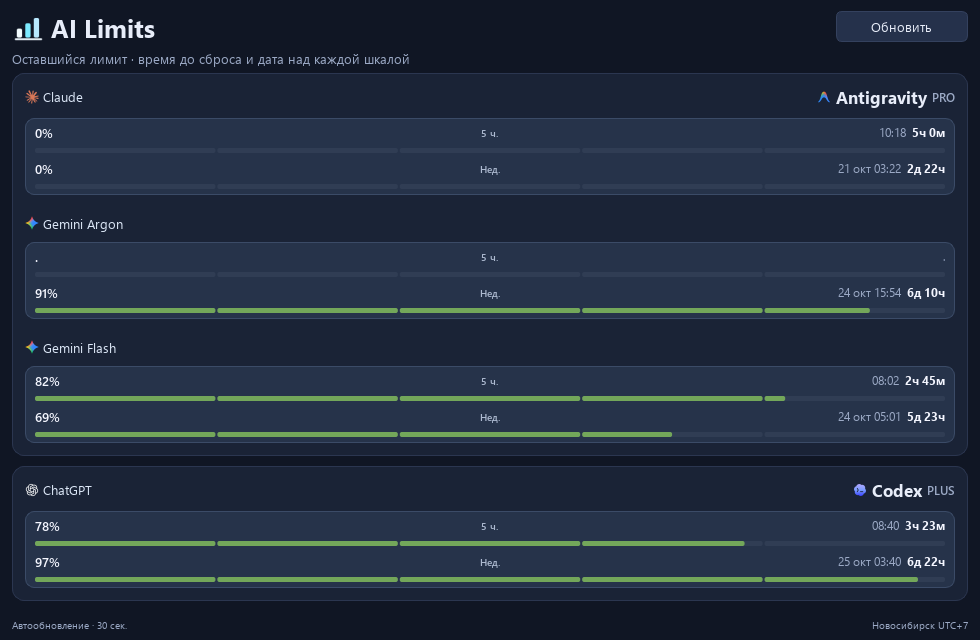
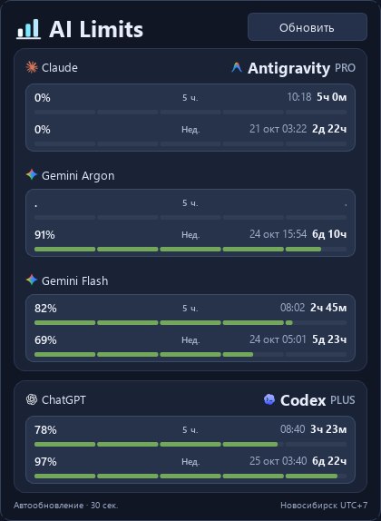

# AI Limits

**A lightweight Windows system-tray dashboard for usage limits from OpenAI Codex and Google Antigravity.**

[Русская версия](README.ru.md)

Unofficial community utility. It reads quota information from the apps already installed and signed in on your computer; it does not need a separate API key or send prompts to a model.

## Screenshots

<p align="center"></p>

<p align="center"></p>

## What it does

- Shows weekly and five-hour quota windows for Codex and Antigravity in one compact panel.
- Refreshes automatically every 30 seconds; a tray-menu action can refresh on demand.
- A single tray click opens a temporary panel; a double-click pins it open.
- Shows reset countdowns in Novosibirsk time (UTC+7).
- Uses the existing Codex and Antigravity sign-ins.

## Requirements

- Windows 64-bit.
- Python 3.12 and the Python launcher (`py`).
- Codex installed and signed in; Antigravity installed, signed in, and running for its quota data.

This repository contains source code, not a ready-to-run `.exe` installer. Users need Python and the project dependencies. No Windows installer is required.

## Run from source

1. Download the repository using **Code → Download ZIP** on GitHub, or clone it with Git.
2. Extract it to a permanent folder; shortcuts point to this location.
3. Install Python 3.12 if it is not already installed.
4. Open PowerShell in the project folder and run:

```powershell
py -3.12 -m venv .venv
& ".\.venv\Scripts\python.exe" -m pip install --upgrade pip
& ".\.venv\Scripts\python.exe" -m pip install -r requirements.txt
& ".\.venv\Scripts\pythonw.exe" ".\app.py" --tray
```

To add a Start menu shortcut, run:

```powershell
& ".\.venv\Scripts\python.exe" ".\app.py" --install-shortcut
```

The tray menu can optionally add the app to the current Windows user's Startup folder. Right-click the tray icon and select **Запускать вместе с Windows** ("Start with Windows"). This is off by default and does not require administrator access.

To exit, right-click the tray icon and choose **Выход**. To stop the app from starting with Windows, uncheck **Запускать вместе с Windows** in the same menu.

## Data and privacy

- **Codex:** the app starts the locally installed `codex.exe` app-server and reads quota and model-catalog data through the existing Codex sign-in. It does not submit prompts or require an API key.
- **Antigravity:** the app finds the local Antigravity language-server process and reads its quota service over loopback (`127.0.0.1`). A local CSRF token is read from that process and used only for requests to its local service; the widget does not save it.
- UI preferences and the last quota snapshot are stored in `%LOCALAPPDATA%\QuotaWidget` as `settings.json` and `cache.json`. These files do not contain OAuth credentials.
- The local single-instance control channel is restricted to the current Windows account.
- The app does not change system proxy settings, install a service, or require administrator privileges.

## Limitations

Antigravity currently exposes this quota data through an internal local service rather than a documented public API. An Antigravity update may change that interface and temporarily break quota reading. Both providers may report shared quota groups; a model catalog is not a promise that every model has its own separate limit.

The project is not affiliated with or endorsed by OpenAI, Google, or Anthropic. Their names and marks identify the connected services. Third-party artwork and its sources are listed in [`assets/brands/SOURCES.md`](assets/brands/SOURCES.md); those marks are not relicensed by this project's MIT license.

## Troubleshooting

- **Codex quota is missing:** start Codex and sign in with the account whose limits you want to see.
- **Antigravity quota is missing:** open Antigravity and sign in. The widget reads its local service while the app is running.
- **Tray icon is hidden:** enable it in Windows **Settings → Personalization → Taskbar → Other system tray icons**.

## Development

Run the tests from the project folder:

```powershell
& ".\.venv\Scripts\python.exe" -m unittest -v
```

See [`CONTRIBUTING.md`](CONTRIBUTING.md) for the development notes.

## License

The project source code is licensed under the MIT License; see [`LICENSE`](LICENSE). This license does not grant rights to third-party trademarks or artwork in `assets/brands`.
